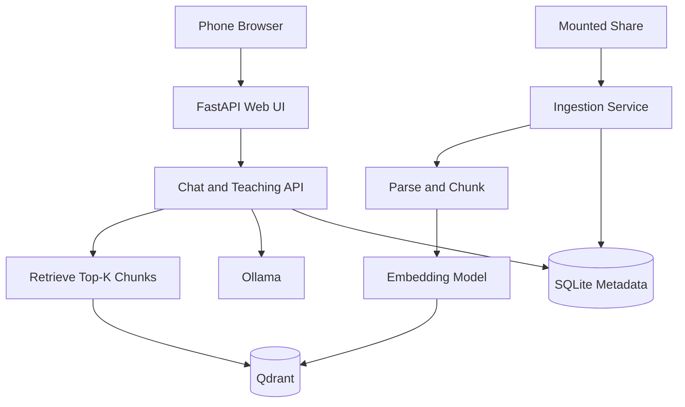
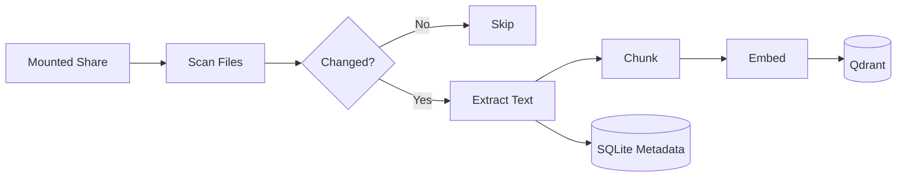
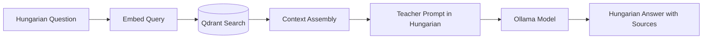
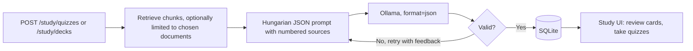
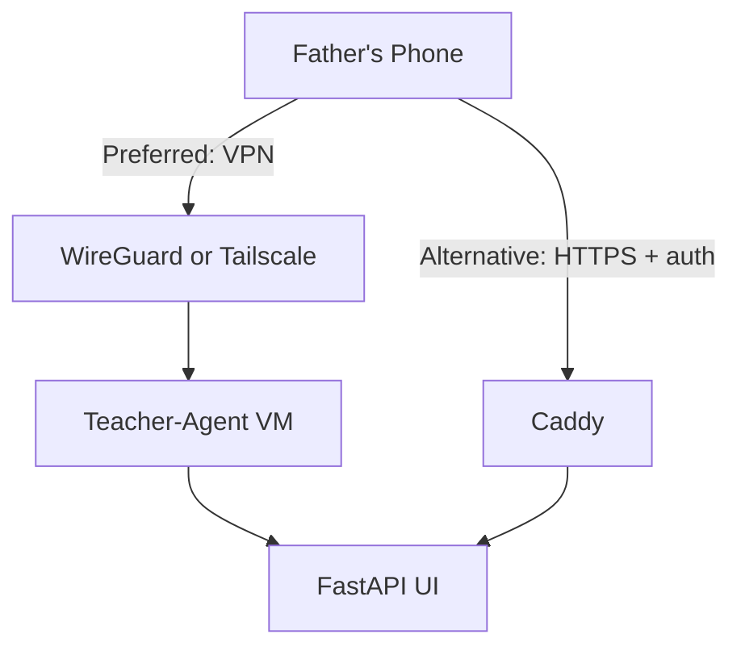
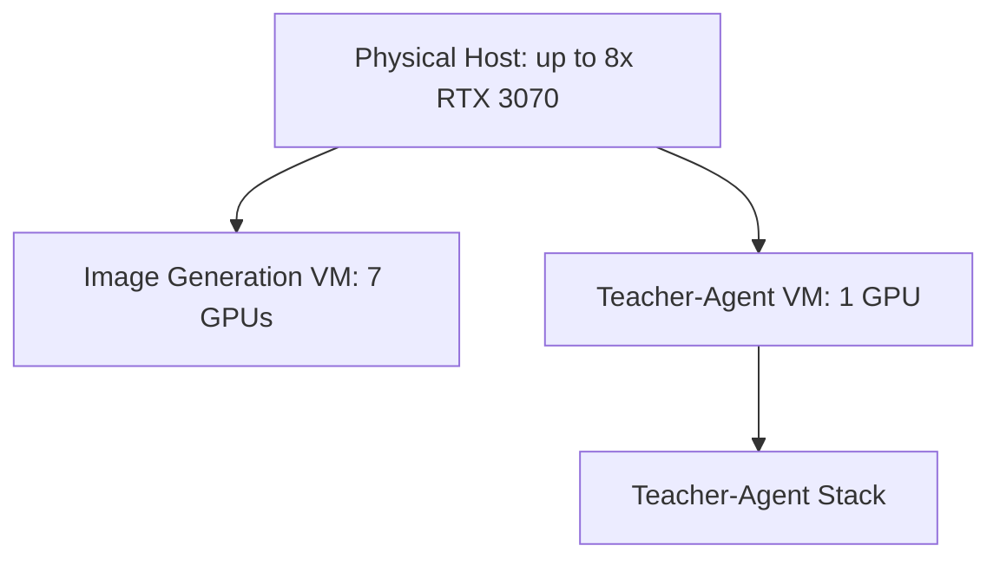

# Architecture

The MVP is a text-first RAG system designed for a dedicated teacher-agent VM. It is intentionally separate from any other AI workload stack.

## Core Services

- `api`: mobile-friendly web UI and JSON API
- `ingestion`: scans the mounted share and updates local indexes
- `qdrant`: vector storage
- `ollama`: local LLM runtime
- `sqlite`: local metadata state stored on the host, not a separate container
- `voice`: optional offline Hungarian STT (faster-whisper) and TTS (Piper), added with `compose/docker-compose.voice.example.yml`

## High-Level Flow

## Ingestion Flow

## Chat Flow

## Stored Quizzes and Flashcards

Quizzes and flashcard decks are generated once from the indexed documents and stored in SQLite, so they can be studied repeatedly without calling the model again. The on-demand `/quiz` and `/flashcards` endpoints still exist and return unstored free text.

- Code: `services/api/app/study_routes.py` (router, included in `main.py` with the auth dependency), `teacher_common/study.py` (prompt building, parsing, validation, SM-2), `study_store.py` (queries), `study_models.py` (tables). Prompts: `config/prompts/quiz_hu.md`, `flashcards_hu.md`.
- Tables: `quiz_sets`, `quiz_questions`, `quiz_attempts`, `flashcard_decks`, `flashcards`.
- Source references: the model sees numbered chunks and answers with those numbers; each is mapped to `{chunk_id, source_path, title, locator}`. Invented numbers are dropped and an item without a valid reference is rejected.
- Validation and retry: output must be JSON matching the schema (quiz: 2-6 unique options, `correct_index` in range). Invalid items are dropped; if nothing valid remains the model is asked again with the problem described, up to `STUDY_MAX_ATTEMPTS` (default 2), then the API returns 502 and stores nothing.
- Flashcard review: SM-2 style. Grades `again/hard/good/easy` map to quality 1/3/4/5; intervals go 1 day, 6 days, then `interval x ease` (ease starts at 2.5, minimum 1.3). `again` resets the card and makes it due in 10 minutes. Each card keeps `ease`, `interval_days`, `repetitions`, `lapses`, `due_at`.
- Quiz attempts are graded server-side and stored with the per-question result. Quiz fetches (`GET`/`POST /quizzes`) carry no answer key; `correct_index`, the explanation and source references are returned only in the response to `POST /quizzes/{id}/attempts`.
- Scope: a topic, a list of `source_paths`, or both. Without a topic, retrieval queries with the document titles, which is approximate.
- Schema changes: `init_db()` still uses `create_all` (new tables appear automatically), followed by `teacher_common/migrations.py`, a numbered list of one-off steps recorded in `schema_migrations`. Add changes that `create_all` cannot do (new columns on existing tables) as the next entry; never edit released ones.

API (all under `/study`):

| Method | Path | Purpose |
| --- | --- | --- |
| POST | `/quizzes` | generate and store (`topic?`, `source_paths?`, `level`, `count?`, `title?`) |
| GET | `/quizzes`, `/quizzes/{id}` | list, fetch with questions and sources |
| DELETE | `/quizzes/{id}` | delete with attempts |
| POST | `/quizzes/{id}/attempts` | submit `{answers: {question_id: option_index}}`, returns score |
| GET | `/quizzes/{id}/attempts` | attempt history |
| POST | `/decks` | generate and store a deck |
| GET | `/decks`, `/decks/{id}` | list (with due counts), fetch |
| DELETE | `/decks/{id}` | delete |
| GET | `/decks/{id}/due?limit=` | cards due now |
| POST | `/cards/{id}/review` | `{grade}` updates the schedule |

The UI section "Tanulás" on the main page (`static/study.js`, `study.css`) lists stored items and runs card and quiz sessions.

## Mobile Access Flow

## Optional Voice Flow

```mermaid
flowchart LR
  Mic[Phone Microphone] -->|webm/mp4 upload| API[Teacher API, login + CSRF]
  API -->|/voice/transcribe| STT[faster-whisper large-v3-turbo, CPU]
  STT --> Text[Question text, user checks it]
  Text --> Chat[POST /chat]
  Chat --> Answer[Hungarian answer]
  Answer -->|/voice/speak| TTS[Piper hu_HU voice, CPU]
  TTS --> Audio[MP3 in the browser's player]
```

- The `voice` container is internal only; the API proxies `/voice/*` and reports at `/voice/status` whether it is there. The UI shows the voice controls only then.
- Both engines run on the CPU by default, so the GPU stays with the chat model. `compose/docker-compose.voice.nvidia.example.yml` moves Whisper to the GPU (about 1-1.5 GB, unloaded when idle).
- Engine choice, measurements and configuration: [voice-hungarian.md](voice-hungarian.md).

## VM Split Example

## Design Notes

- The source library remains on the share.
- Index data lives locally for speed.
- Chunk text is stored locally as part of the RAG index payload.
- Sequential ingestion is a deliberate default to protect `16 GB RAM`.

