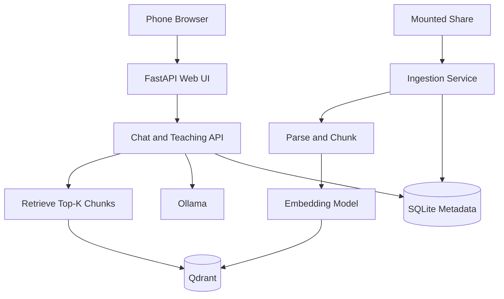
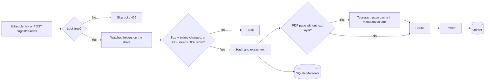
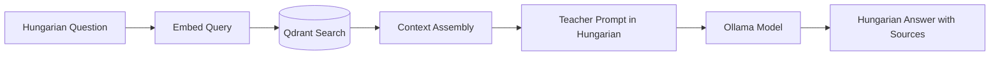
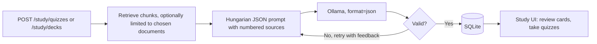
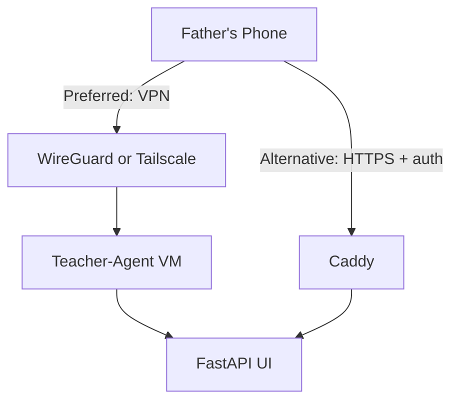
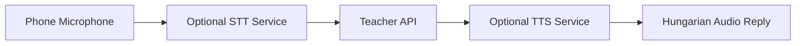
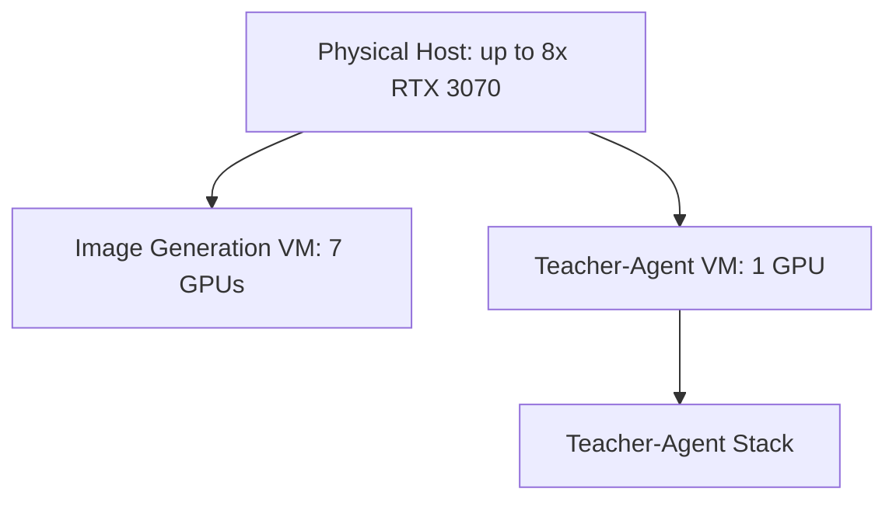

# Architecture

The MVP is a text-first RAG system designed for a dedicated teacher-agent VM. It is intentionally separate from any other AI workload stack.

## Core Services

- `api`: mobile-friendly web UI and JSON API, behind the app login; forwards reindex and schedule calls to `ingestion` with the ingest token
- `ingestion`: scans the watched folders of the mounted share, on its schedule or on request, OCRs scanned PDF pages and updates local indexes
- `qdrant`: vector storage
- `ollama`: local LLM runtime
- `sqlite`: local metadata state stored on the host, not a separate container
- `voice`: optional overlay (`compose/docker-compose.voice.example.yml`): Whisper STT scaffold, TTS not wired yet

`api` and `ingestion` share one SQLite file under `${TEACHER_DATA_DIR}/metadata` (documents, chunks, ingest runs, OCR records, login sessions, quizzes and decks). Both call `init_db()` at startup. SQLite waits up to 30 seconds for the other container's write instead of failing.

## High-Level Flow

## Ingestion Flow

### Runs, OCR and Restarts

- The scheduler is a thread inside the ingestion service (`teacher_common/scheduling.py`). Scheduled and manual runs take one non-blocking lock, so they never overlap: a tick during a run is skipped, a manual request gets `409` (the API passes that on). The next slot is counted from the end of a run; missed slots are not queued.
- A run is sequential, one file at a time. OCR runs inside it, so a long scanned book holds the lock for as long as it takes, bounded per file by `OCR_TIMEOUT_SECONDS` and `OCR_MAX_PAGES`.
- OCR text is cached per page under `OCR_CACHE_DIR` and written after every page. A run stopped mid-file (deploy, restart) loses at most the page in progress.
- A PDF whose OCR stopped on the time budget is picked up again by the next run, which spends a new budget on the remaining pages; cached pages cost nothing. When a run adds no page, the file is marked stalled and left alone. A page-limit stop is not resumed.
- At startup the ingestion service marks runs still recorded as `running` as `interrupted`. The documents those runs finished are kept, and the next run picks up the rest, because unfinished files still look new or changed.
- Details: [document-ingestion.md](document-ingestion.md), [operations.md](operations.md).

### Access

- Every API route except `/health`, `/login` and `/static/*` needs a session. A default-deny middleware in `services/api/app/main.py` checks it, and CSRF and Origin on state-changing requests. New routes, including the study router, are covered without extra code.
- The ingestion service has no login of its own. Its `/ingest/*` endpoints need `TEACHER_INGEST_TOKEN`, and its port is published on `127.0.0.1` only.
- Details: [security.md](security.md).

## Chat Flow

## Stored Quizzes and Flashcards

Quizzes and flashcard decks are generated once from the indexed documents and stored in SQLite, so they can be studied repeatedly without calling the model again. The on-demand `/quiz` and `/flashcards` endpoints still exist and return unstored free text.

- Code: `services/api/app/study_routes.py` (router, included in `main.py` and protected by its session/CSRF middleware), `teacher_common/study.py` (prompt building, parsing, validation, SM-2), `study_store.py` (queries), `study_models.py` (tables). Prompts: `config/prompts/quiz_hu.md`, `flashcards_hu.md`.
- Tables: `quiz_sets`, `quiz_questions`, `quiz_attempts`, `flashcard_decks`, `flashcards`.
- Source references: the model sees numbered chunks and answers with those numbers; each is mapped to `{chunk_id, source_path, title, locator}`. Invented numbers are dropped and an item without a valid reference is rejected.
- Validation and retry: output must be JSON matching the schema (quiz: 2-6 unique options, `correct_index` in range). Invalid items are dropped; if nothing valid remains the model is asked again with the problem described, up to `STUDY_MAX_ATTEMPTS` (default 2), then the API returns 502 and stores nothing.
- Flashcard review: SM-2 style. Grades `again/hard/good/easy` map to quality 1/3/4/5; intervals go 1 day, 6 days, then `interval x ease` (ease starts at 2.5, minimum 1.3). `again` resets the card and makes it due in 10 minutes. Each card keeps `ease`, `interval_days`, `repetitions`, `lapses`, `due_at`.
- Quiz attempts are graded server-side and stored with the per-question result. Quiz fetches (`GET`/`POST /quizzes`) carry no answer key; `correct_index`, the explanation and source references are returned only in the response to `POST /quizzes/{id}/attempts`.
- Scope: a topic, a list of `source_paths`, or both. Without a topic, retrieval queries with the document titles, which is approximate.
- Schema changes: `init_db()` still uses `create_all` (new tables such as `ocr_documents`, `auth_sessions` and the study tables appear automatically), followed by `teacher_common/migrations.py`, a numbered list of one-off steps recorded in `schema_migrations`. Add changes that `create_all` cannot do (new columns on existing tables) as the next entry; never edit released ones. So far no feature has needed one beyond the baseline.

API (all under `/study`):

| Method | Path | Purpose |
| --- | --- | --- |
| POST | `/quizzes` | generate and store (`topic?`, `source_paths?`, `level`, `count?`, `title?`) |
| GET | `/quizzes`, `/quizzes/{id}` | list, fetch with questions and sources |
| DELETE | `/quizzes/{id}` | delete with attempts |
| POST | `/quizzes/{id}/attempts` | submit `{answers: {question_id: option_index}}`, returns score |
| GET | `/quizzes/{id}/attempts` | attempt history |
| POST | `/decks` | generate and store a deck |
| GET | `/decks`, `/decks/{id}` | list (with due counts), fetch |
| DELETE | `/decks/{id}` | delete |
| GET | `/decks/{id}/due?limit=` | cards due now |
| POST | `/cards/{id}/review` | `{grade}` updates the schedule |

The UI section "Tanulás" on the main page (`static/study.js`, `study.css`) lists stored items and runs card and quiz sessions.

## Mobile Access Flow

## Optional Voice Flow

## VM Split Example

## Design Notes

- The source library remains on the share.
- Index data lives locally for speed.
- Chunk text is stored locally as part of the RAG index payload.
- Sequential ingestion is a deliberate default to protect `16 GB RAM`.
- Only folders listed in `config/ingestion/ingestion.yml` are scanned; the share may hold far more than is indexed.
- Stored quizzes and decks keep a copy of their source references (path, title, locator), not foreign keys, so a reindex or a deleted document does not break them.

