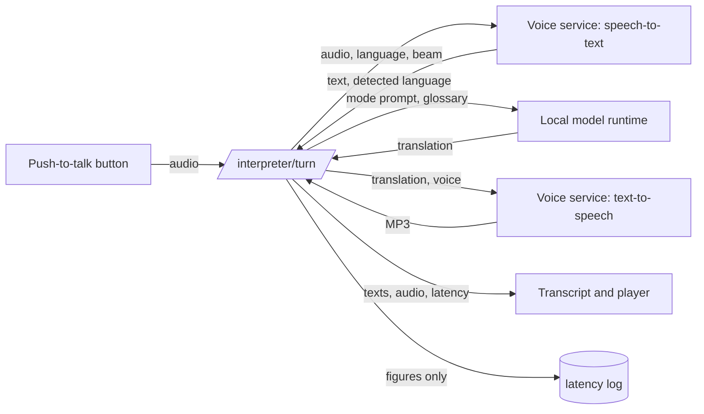

# Tolmács: push-to-talk interpreter (Hungarian ↔ English)

Tolmács interprets one utterance at a time. A person holds or taps the button for their language, speaks, and the
other language is shown in a two-column transcript and spoken aloud. Everything runs on the local stack: speech
recognition and speech synthesis in the voice service, translation in the local model runtime. Continuous two-way
interpreting (overlapping speech, streaming) is out of scope; turn-taking is the reliable starting point.

## Using it

- Two big buttons, one per language (HU, EN), and an `Auto` button that detects the spoken language (Hungarian or
  English only; anything else is refused with a message). Hold the button and release to send, or tap once to start
  and tap again to stop.
- Without a microphone, or while the voice service is down, a text field under the transcript translates typed
  sentences; the translation is then shown without audio.
- A session can be saved (the transcript and its latency figures, never audio), reopened later, updated, deleted and
  exported as Markdown, plain text, CSV or JSON. Saved sessions belong to the signed-in account; another account
  gets a 404.

## Modes

| | Fast | Professional |
| --- | --- | --- |
| Goal | shortest chain | terminology and fidelity |
| Prompt | one line (`interpreter_fast_*.md`) | rules for numbers, names, terms, tone (`interpreter_pro_*.md`) |
| Glossary | ignored | applied when the user supplies one (`source = target` per line) |
| Model | `modes.fast.model` | `modes.professional.model` |
| Speech recognition | beam size 1 | beam size 5 |
| Generation | small context and reply limit | larger context and reply limit |

The per-mode settings live in `config/models/interpreter.json` (path: `INTERPRETER_CONFIG_PATH`). An empty `model`
means the stack's chat model (`OLLAMA_MODEL`); to use a smaller model for Fast, put its name there. The model must
already be installed in the local runtime; no model is downloaded or named in code. Without the file the built-in
defaults (same as the shipped file) are used. `tts_voices` can pin a voice per language; otherwise the first
installed voice whose name starts with the language code (`hu_`, `en_`) is used.

English speech needs an English voice next to the Hungarian ones. The shipped voice image and Compose defaults include one
(`VOICE_TTS_VOICES`, see [voice-hungarian.md](voice-hungarian.md)); if the target language has no installed voice, the
row shows the text with a notice and no audio is requested (the voice service is never allowed to substitute its
default Hungarian voice). Hungarian abbreviation expansion is applied only to Hungarian voices.
The speech recogniser is multilingual, so no extra model is needed for English or auto-detection.

## What is measured

For every utterance the server times, with a monotonic clock:

- `stt_ms`: speech-to-text (absent for typed input)
- `translate_ms`: the model call
- `tts_ms`: speech synthesis (absent when it was skipped; recorded even if it failed)
- `total_ms`: the whole chain on the server, including the small gaps between stages

These figures are server-side. They do not include the upload from the browser, the download of the audio, or the
time to play it. They are shown under every transcript row, saved with the session and appended, as one JSON line, to
`INTERPRETER_LATENCY_LOG` (default `/data/metadata/interpreter_latency.jsonl`). A log line holds the figures, mode,
direction, account name, text lengths and model name, but never the spoken or translated text, and never audio.

Summaries (nearest-rank p50, p95 and max per mode and stage):

- in the UI: the "Késleltetés" section (the signed-in account's own utterances)
- `GET /interpreter/latency` (`?scope=all` for administrators)
- `python3 scripts/interpreter_latency.py <log file> [--user NAME] [--json]`, which also works on a copy of the log

## Latency is unvalidated

The automated tests use fake speech recognition, synthesis and model stages: they verify the chain, the bookkeeping
and the mode differences, not speed. No real-hardware latency has been measured yet, and no target such as "under N
seconds" is claimed. Per-stage cost depends on the model sizes, whether the voice service and the model runtime
share a processor, and on how long the person spoke. Run a set of real utterances on the target hardware in both
modes, read the summary, and only then choose the Fast model and decide whether the Professional mode is usable
for live conversation.

## Limits

- A translation cut off by the model's reply limit is refused with a request to speak in shorter parts, never shown or spoken as if complete.
- CSV export prefixes transcript cells that start with `=`, `+`, `-` or `@` with an apostrophe so spreadsheets read them as text; Markdown, text and JSON keep the original.
- One utterance per request; recordings are capped at 60 seconds in the UI and by the voice service limit.
- Typed text up to 1000 characters in the UI (4000 on the API); glossary up to 4000 characters.
- At most 500 turns per saved session and 200 saved sessions per account.
