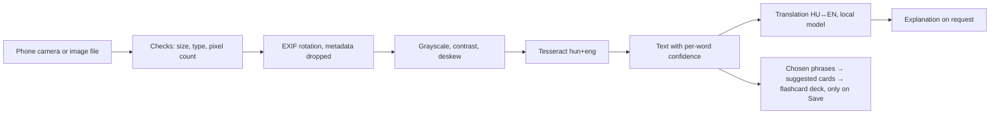

# Photo Text (Média)

Read the text in a photo, translate it between Hungarian and English, and keep useful phrases as flashcards. Everything runs on the server: no image or text leaves it.

## Flow

- **Upload.** `<input type=file accept=image/* capture=environment>` opens the camera on a phone; a second button picks an existing image. JPEG, PNG and WebP up to 10 MB and 24 megapixels. The format and pixel count are read from the header before the bitmap is decoded, so a small file that unpacks to a huge image is refused.
- **Preprocessing.** The photo is turned upright from its EXIF orientation, converted to grayscale, scaled to a size Tesseract reads well, contrast-stretched, and straightened when the text is tilted by up to 10°.
- **Recognition.** Tesseract with `OCR_LANGUAGE` (default `hun+eng`). Words below `OCR_LOW_CONFIDENCE` are underlined as uncertain. The translation direction is detected from the text unless chosen.
- **Translation and explanation.** The configured local chat model, with the same translation prompts as Document Intelligence (`config/prompts/docintel_translate_*.md`); the explanation uses `media_explain_hu.md`. The text can be shown as original or translated.
- **Flashcards.** Tap words in the text (neighbouring words form one phrase) or type a phrase, let the model suggest the other side, edit the pairs, then save. Nothing goes into the study material until the person presses Save; the deck then appears under Tanulás. Deleting the photo later keeps the deck.

## Storage and privacy

Each photo belongs to the person who uploaded it (their personal workspace) and is never listed for anyone else, administrators included. The stored copy is an upright JPEG of at most 1600 px without metadata (no location), kept in the metadata database with the text, translation and explanation, so backups include it. Delete removes the photo and all its results.

## Settings

| Variable | Default | Meaning |
| --- | --- | --- |
| `MEDIA_VISION_MODEL` | empty | A local Ollama vision model to read photos with instead of Tesseract; Tesseract remains the fallback |
| `MEDIA_OCR_TIMEOUT_SECONDS` | `60` | Time limit for reading one photo |
| `MEDIA_MAX_ITEMS_PER_USER` | `200` | Photos kept per person |
| `OCR_LANGUAGE`, `OCR_LOW_CONFIDENCE` | `hun+eng`, `70` | Shared with document OCR |

The API image installs `tesseract-ocr` with the Hungarian and English language packs.

## API

All under the login, scoped to the signed-in person: `POST /media/items` (multipart `image`, `direction` = `auto`/`hu-en`/`en-hu`), `GET /media/items`, `GET /media/items/{id}`, `GET /media/items/{id}/image`, `DELETE /media/items/{id}`, `POST /media/items/{id}/translate`, `POST /media/items/{id}/explain`, `POST /media/items/{id}/glossary` (suggested pairs, nothing saved), `POST /media/items/{id}/deck` (saves the deck).

## Limits

Handwriting, very small print and strong glare read poorly with Tesseract; a local vision model may do better where one fits the hardware. Text rotated 90° without EXIF orientation is not turned automatically.
